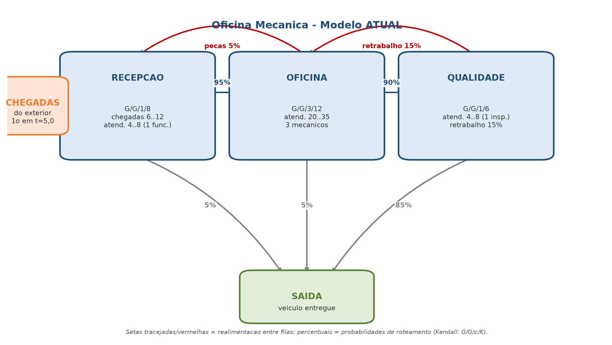
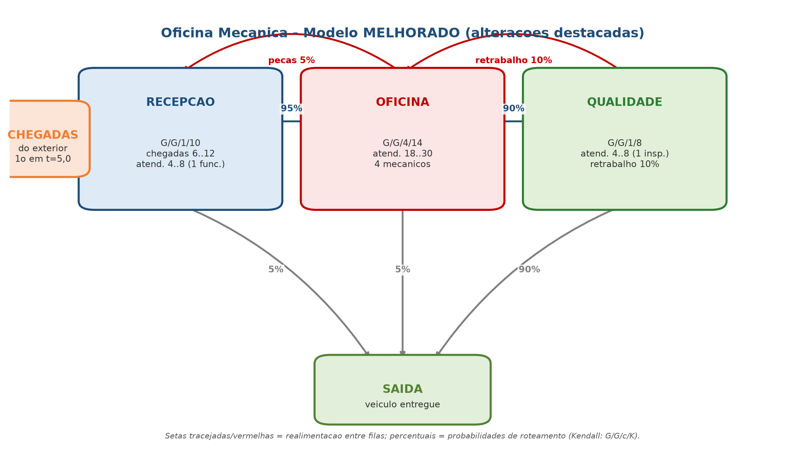

# T2 | Avaliação de Aprendizagem — Oficina Mecânica

Trabalho T2 da disciplina **Simulação e Métodos Analíticos** (PUCRS, 2026/2).
Modela, simula e melhora uma **rede de filas com realimentação** de uma oficina
mecânica, usando o simulador de eventos discretos desenvolvido no T1.

> Grupo: **T2 - 690 - 16** · Entrega: 14/10/2026 · Integrantes: preencher na capa
> (placeholder `Integrante 1..6`).

## A realidade modelada

Uma oficina mecânica recebe veículos para reparo:

- **RECEPÇÃO** — abertura de ordem de serviço e orçamento (1 funcionário).
- **OFICINA** — execução do reparo (3 mecânicos, na situação atual).
- **QUALIDADE** — teste do serviço (1 inspetor).

A rede **não é um fluxo em tandem**: existe **realimentação** entre as filas.

- **Retrabalho:** se o teste reprova, o veículo **volta da QUALIDADE para a OFICINA**.
- **Peças/orçamento:** parte dos serviços **volta da OFICINA para a RECEPÇÃO**.

Somente a RECEPÇÃO recebe clientes do exterior.



## Modelo inicial (situação atual)

| Fila | Notação (Kendall) | Chegadas externas | Atendimento | Servidores | Capacidade |
|---|---|---|---|---|---|
| RECEPÇÃO | G/G/1/8 | U(6;12), 1ª em t=5,0 | U(4;8) | 1 | 8 |
| OFICINA | G/G/3/12 | — | U(20;35) | 3 | 12 |
| QUALIDADE | G/G/1/6 | — | U(4;8) | 1 | 6 |

Roteamento (`network`):

- RECEPÇÃO → OFICINA: 0,95 · RECEPÇÃO → SAÍDA: 0,05
- OFICINA → QUALIDADE: 0,90 · OFICINA → RECEPÇÃO: 0,05 · OFICINA → SAÍDA: 0,05
- QUALIDADE → OFICINA: 0,15 (retrabalho) · QUALIDADE → SAÍDA: 0,85

Arquivo: [`modelos/oficina.yml`](modelos/oficina.yml).

## Gargalo identificado

A **OFICINA** opera saturada:

- Utilização **U = 99,98 %** (os 3 mecânicos ficam ocupados praticamente todo o tempo);
- População média **N = 10,74** de 12 vagas e tempo de resposta **W = 98,44 min**;
- **21.406 perdas** de clientes por fila cheia.

Carga oferecida (~0,1291 cliente/min) maior que a capacidade instalada
(3 × 1/27,5 = 0,1091 cliente/min), ou seja **ρ ≈ 1,18 > 1**.

## Proposta de melhoria

Modelo melhorado ([`modelos/oficina_melhorada.yml`](modelos/oficina_melhorada.yml)),
com as alterações destacadas no desenho:



- **OFICINA:** 3 → 4 mecânicos, capacidade 12 → 14, atendimento U(20;35) → U(18;30)
  (novo mecânico + elevador/ferramenta).
- **QUALIDADE:** capacidade 6 → 8 e retrabalho 15 % → 10 % (treinamento).
- **RECEPÇÃO:** capacidade 8 → 10 (evita perdas de ordens na chegada).

## Resultados (10 sementes × 100.000 aleatórios)

| Fila | Perdas (atual → melhorada) | N | D (vazão/min) | U | W (min) |
|---|---|---|---|---|---|
| RECEPÇÃO | 0 → 0 | 0,75 → 0,77 | 0,1164 → 0,1173 | 69,9 % → 70,4 % | 6,46 → 6,53 |
| **OFICINA** | **21.406 → 0** | **10,74 → 3,01** | **0,1091 → 0,1224** | **99,98 % → 73,46 %** | **98,44 → 24,61** |
| QUALIDADE | 0 → 0 | 0,73 → 0,85 | 0,0983 → 0,1103 | 58,9 % → 66,2 % | 7,48 → 7,75 |

Na OFICINA o tempo de resposta cai ~75 % e as perdas são zeradas; a vazão
aumenta ~12 % com utilização confortável (73 %).

## Índices de desempenho (fórmulas do M9)

Com E[S] = (minService + maxService)/2 e MU = 1/E[S]:

- **População:** `N = Σ k · P(estado k)`
- **Vazão:** `D = MU · Ns`, onde `Ns = Σ min(k, servidores) · P(k)` é a ocupação média dos servidores
- **Utilização:** `U = Ns / servidores = D / (servidores · MU)`
- **Tempo de resposta:** `W = N / D` (Lei de Little)

A conversão do tempo médio de atendimento para a taxa média de atendimento
(`MU = 1/E[S]`) é o ponto de atenção destacado no enunciado.

## Como reproduzir

Requer Python 3 e PyYAML (`pip install pyyaml`):

```bash
cd T2
python3 simulador.py modelos/oficina.yml            # situação atual
python3 simulador.py modelos/oficina_melhorada.yml  # situação melhorada
python3 gerar_planilha.py                           # planilha de índices
python3 gerar_desenho.py                            # desenhos da rede
python3 gerar_apresentacao.py                       # PPTX
python3 gerar_pdf.py                                # HTML + gráficos (PDF via navegador)
```

Dependências: o simulador usa apenas `pyyaml`. Os scripts auxiliares de geração
usam bibliotecas adicionais: `gerar_planilha.py` (openpyxl), `gerar_desenho.py`
e `gerar_pdf.py` (matplotlib) e `gerar_apresentacao.py` (python-pptx).

Veja [`INSTRUCOES.md`](INSTRUCOES.md) para o formato do `.yml` e a descrição da saída.

## Estrutura

```
T2/
├── simulador.py                     simulador de rede de filas + índices
├── modelos/
│   ├── oficina.yml                  modelo atual
│   └── oficina_melhorada.yml        modelo melhorado
├── resultados/
│   ├── oficina_atual.txt            saída completa (atual)
│   └── oficina_melhorada.txt        saída completa (melhorada)
├── planilhas/
│   ├── indices_oficina.xlsx         índices, estados e comparação
│   └── indices_oficina.csv
├── apresentacao/
│   ├── T2_Oficina_Mecanica.pptx     apresentação
│   ├── T2_Oficina_Mecanica.pdf      apresentação em PDF
│   ├── T2_Oficina_Mecanica.html     fonte dos slides em PDF
│   └── rede_filas_*.png, grafico_*.png
├── gerar_planilha.py
├── gerar_desenho.py
├── gerar_apresentacao.py
├── gerar_pdf.py
├── INSTRUCOES.md
└── README.md
```

## Vídeo

> Link do vídeo (YouTube) comentando a apresentação: **preencher**.
